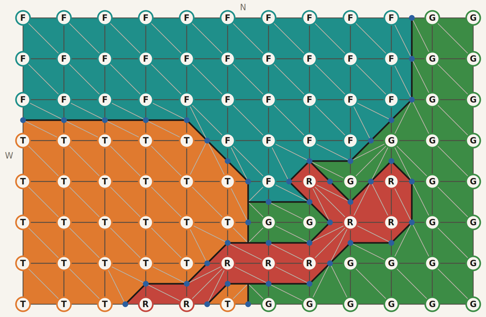

# Midpoint biome edges

Status: New

## Story

The player looks across the ground where two biomes meet. Each 2 m square takes its colour from the method in use. With NorthWest, the square takes the northwest corner, so the boundary steps from point to point. With the midpoint method, the boundary passes through the middle of any edge whose ends differ. A straight run of one biome against another is a straight edge. A road that steps across the grid stays one strip, because a road outranks the ground beside it. Ctrl+Shift+M cycles the method while the player watches, and the edge changes. The terrain points stay where they are.

## Acceptance

- A quad is built from the triangles the selected method returns. NorthWest, OddCorner, and NorthWestCut each return two, and those two match the triangles they return now. The existing quad-triangle checks still pass.
- QuadMaterial is renamed to QuadSplit. Its type is ESolidQuadSplit. NorthWest, OddCorner, and NorthWestCut keep those names.
- QuadSplit selects the method. It starts as NorthWest. Ctrl+Shift+M cycles the values while playing, the loaded ground rebuilds, and NorthWest is still one of the values. Selecting it again restores those two triangles.
- The new value follows the midpoint split in the notes. An edge whose ends match adds no vertex. An edge whose ends differ gets one vertex in the middle, and the neighbouring quad uses that same vertex.
- On a checker, the biome further right in the order stays joined. The order, lowest first, is Sea, Grassland, Forest, Desert, Mountain, Town, River, Road.
- The patch below shows all seven cases. A test of the new value checks that patch.
- The debug readout shows the name of the method in use.
- In Play In Editor, with the new value selected, a biome boundary runs through those midpoints. With NorthWest selected, the ground keeps the corners it has now.

## Implementation notes

The mesh is changed first so a quad can hold as many triangles as the method returns. NorthWest, OddCorner, and NorthWestCut keep returning two, the same two they return now. Once that still matches, the midpoint method is added as a value of QuadSplit. Ctrl+Shift+M cycles the values in enum order, and the loaded chunks rebuild. This story introduces no new class.

The patch is eight rows by twelve points, the middle of a chart export with a road added. The first row is north and the first character of a row is west. F is forest, T is town, G is grassland, and R is road.



```
FFFFFFFFFFGG
FFFFFFFFFFGG
FFFFFFFFFFGG
TTTTTFFFFGGG
TTTTTTFRGRGG
TTTTTTGGRRGG
TTTTTRRRGGGG
TTTRRTGGGGGG
```

Walk one 2 m quad at a time. The corners are the four terrain points. The first case that matches is the one used. Every triangle carries one material, the biome of the region it belongs to.

1. All four corners match. Two triangles, both of that material. The diagonal runs from the northwest corner to the southeast. No extra vertex.
2. One side is a pair, and the opposite side is the other pair. North matches north and south matches south, or west matches west and east matches east. Put a vertex halfway along each of the two edges the boundary crosses. Each half is two triangles of that half's material.
3. Both diagonals are pairs. Northwest matches southeast, and northeast matches southwest. This is a checker. The pair further right in the order becomes one band through the quad, four triangles of that material. Each of the other two corners becomes one triangle of its own material.
4. Only one diagonal is a pair. That pair becomes the band. The other two corners keep one triangle each, so they may be two different materials.
5. Three corners match. The odd corner keeps the triangle between that corner and the midpoints of its two edges. The other three corners share the remaining piece, three triangles of their material.
6. Two adjacent corners are the highest material, and the other two differ. The high pair takes that half of the quad, two triangles. The other half is split between the two lower materials. They meet at the middle of the cut.
7. One corner is the highest material, and the opposite side is a matching pair. The high corner keeps its triangle. The matching pair takes the side it occupies. The remaining corner takes what is left beside the high triangle.

The mesh and the debug line both read the method's triangles, so a method can return more than two. The three current methods keep returning two.
